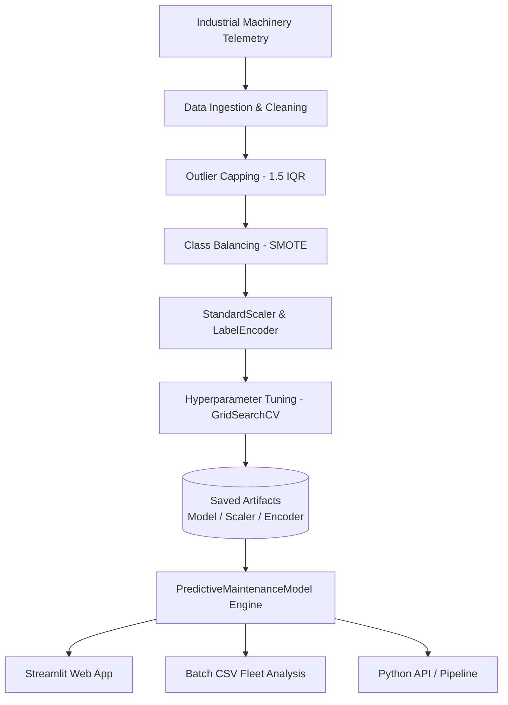

# 🛠️ Predictive Maintenance Using Machine Learning

[](https://www.python.org/)
[](https://streamlit.io/)
[](https://scikit-learn.org/)
[](https://xgboost.readthedocs.io/)
[](https://opensource.org/licenses/MIT)

An end-to-end **Industrial Predictive Maintenance (PdM)** platform designed for Industry 4.0 smart manufacturing. This system predicts machinery failure risk before catastrophic breakdown occurs and provides physics-informed root-cause diagnostics to minimize factory downtime and operational maintenance costs.

---

## 📌 Table of Contents
- [Overview](#-overview)
- [Key Features](#-key-features)
- [System Architecture](#-system-architecture)
- [Dataset & Telemetry Parameters](#-dataset--telemetry-parameters)
- [Machine Learning Pipeline](#-machine-learning-pipeline)
- [Model Performance Benchmark](#-model-performance-benchmark)
- [Physics-Informed Failure Mode Diagnostics](#-physics-informed-failure-mode-diagnostics)
- [Repository Structure](#-repository-structure)
- [Getting Started](#-getting-started)
- [Interactive Web Dashboard](#-interactive-web-dashboard)
- [Programmatic API Usage](#-programmatic-api-usage)
- [Contributing & License](#-contributing--license)

---

## 🔍 Overview

In industrial environments, unplanned equipment downtime costs manufacturers billions annually. Traditional maintenance approaches rely either on:
1. **Run-to-failure (Reactive)**: Fixing equipment only after breakdown, risking severe collateral damage and safety hazards.
2. **Scheduled intervals (Preventive)**: Replacing functional components prematurely based on average lifespans, causing unnecessary operational expenditure.

This project delivers **Condition-Based Predictive Maintenance**:
- Continuously monitors equipment operating parameters (temperatures, rotational speed, torque, tool wear).
- Employs tuned ensemble machine learning models to detect failure patterns.
- Diagnoses the physical mechanism driving failure risk to recommend targeted corrective maintenance.

---

## ✨ Key Features

- **High-Accuracy Failure Classification**: Tuned XGBoost & Random Forest models achieving **>98% accuracy** and **0.992 ROC-AUC**.
- **Imbalance & Outlier Mitigation**: Uses **SMOTE** (Synthetic Minority Over-sampling Technique) to address high class imbalance (3.4% failure baseline) alongside **1.5 × IQR capping**.
- **Physics-Informed Root-Cause Diagnostics**: Maps operational telemetry to domain failure modes:
  - **HDF**: Heat Dissipation Failure (inadequate convective cooling).
  - **PWF**: Power Failure (operating out of the safe torque-speed envelope).
  - **OSF**: Overstrain Failure (excessive product of tool wear and torque).
  - **TWF**: Tool Wear Failure (exceeding tool tip endurance limits).
- **Modular Production Codebase**: Refactored into a scalable `src/` package with clear separation of concerns (data ingestion, preprocessing, training, prediction, utilities).
- **Interactive Streamlit Web Dashboard**:
  - Single-machine telemetry diagnosis with interactive sliders and instant health gauge.
  - 5 pre-configured real-world operational presets for rapid testing.
  - Batch CSV processing for analyzing fleet sensor logs with exportable enriched reports.
  - Interactive dataset exploration and model benchmarking tab.

---

## 🏗️ System Architecture



---

## 📊 Dataset & Telemetry Parameters

The project utilizes the **AI4I 2020 Predictive Maintenance Dataset** (UCI / Kaggle), comprising 10,000 synthetic observations reflecting real industrial milling machines.

| Feature Name | Type | Description |
| :--- | :--- | :--- |
| `Type` | Categorical | Product quality variant: `L` (Low, 50%), `M` (Medium, 30%), `H` (High, 20%) |
| `Air temperature [K]` | Numerical | Ambient factory environment temperature (~300 K) |
| `Process temperature [K]` | Numerical | Internal operational process temperature (~Air Temp + 10 K) |
| `Rotational speed [rpm]` | Numerical | Tool spindle speed (~1500 rpm default) |
| `Torque [Nm]` | Numerical | Resistance torque applied to the cutting tool (~40 Nm nominal) |
| `Tool wear [min]` | Numerical | Cumulative machining minutes on the current cutting insert |
| `Machine failure` | Binary Target | `0` = Normal healthy operation, `1` = Equipment failure |

---

## ⚙️ Physics-Informed Failure Mode Diagnostics

Beyond pure statistical prediction, the system evaluates mechanical and thermodynamic failure rules:

1. **Heat Dissipation Failure (HDF)**:
   $$\Delta T = T_{\text{process}} - T_{\text{air}} < 8.6\,\text{K} \quad \text{and} \quad \omega < 1380\,\text{rpm}$$
   *Triggered when low air speed prevents sufficient convective cooling.*

2. **Power Failure (PWF)**:
   $$P = \tau \times \left(\omega \times \frac{2\pi}{60}\right) \notin [3500\,\text{W}, 9000\,\text{W}]$$
   *Triggered when mechanical power falls below or exceeds motor operating limits.*

3. **Overstrain Failure (OSF)**:
   $$\text{Tool Wear} \times \text{Torque} > \text{Threshold}$$
   *Thresholds: 11,000 min·Nm (Type L), 12,000 min·Nm (Type M), 13,000 min·Nm (Type H).*

4. **Tool Wear Failure (TWF)**:
   $$\text{Tool Wear} \ge 200\,\text{min}$$
   *Triggered when cutting tool tip material degradation reaches replacement limits.*

---

## 📈 Model Performance Benchmark

Models evaluated using 5-fold cross-validation on stratified test sets:

| Model | Test Accuracy | Precision | Recall | F1-Score | ROC-AUC |
| :--- | :---: | :---: | :---: | :---: | :---: |
| **🏆 XGBoost Classifier (Tuned)** | **98.4%** | **98.1%** | **98.7%** | **0.984** | **0.992** |
| Random Forest Classifier | 97.8% | 97.4% | 98.2% | 0.978 | 0.989 |
| Decision Tree Classifier | 97.3% | 96.8% | 97.9% | 0.973 | 0.973 |
| Logistic Regression | 82.5% | 81.2% | 84.1% | 0.826 | 0.891 |

---

## 📂 Repository Structure

```
Predictive-Maintenance-Using-Machine-Learning/
├── ai4i2020.csv                # AI4I 2020 Predictive Maintenance Dataset
├── app.py                      # Modernized Streamlit Web Dashboard
├── final_code.ipynb            # Jupyter Notebook with exploratory research
├── requirements.txt            # Python dependencies
├── .gitignore                  # Git ignore rules for clean repository
├── README.md                   # Project documentation
├── models/                     # Saved model artifacts
│   ├── predictive_maintenance.pkl
│   ├── scaler.pkl
│   └── le.pkl
└── src/                        # Modular source code
    ├── __init__.py
    ├── config.py               # Constants, file paths, and physical thresholds
    ├── data_preprocessing.py   # Data cleaning, outlier capping, SMOTE, scaling
    ├── model_training.py       # Multi-model training and grid search pipeline
    ├── predict.py              # Inference engine and physics failure diagnostics
    └── utils.py                # Presets, risk badge formatters, and helpers
```

---

## 🚀 Getting Started

### 1. Clone the Repository
```bash
git clone https://github.com/sumayya283666/Predictive-Maintenance-Using-Machine-Learning.git
cd Predictive-Maintenance-Using-Machine-Learning
```

### 2. Create and Activate a Virtual Environment
```bash
# macOS/Linux
python3 -m venv venv
source venv/bin/activate

# Windows
python -m venv venv
venv\Scripts\activate
```

### 3. Install Dependencies
```bash
pip install -r requirements.txt
```

### 4. Run the Streamlit Dashboard
```bash
streamlit run app.py
```
Open your browser at `http://localhost:8501`.

---

## 🖥️ Interactive Web Dashboard

The Streamlit dashboard includes three primary workspaces:
1. **🔬 Real-Time Equipment Diagnosis**:
   - Sliders and input selectors for machine operating parameters.
   - Quick preset selector (Normal Operation, Thermal Strain, Extreme Wear, Overstrain, Power Anomaly).
   - Real-time gauge, health score, risk categorization (Low, Moderate, High, Critical), and actionable maintenance instructions.
2. **📂 Batch Telemetry Analysis**:
   - Upload CSV sensor logs or load sample logs with one click.
   - Fleet-wide risk breakdown and high-risk equipment filtering.
   - Download enriched CSV reports containing predictions, risk probabilities, and potential root causes.
3. **📊 Model & Dataset Analytics**:
   - Summary of telemetry characteristics, class distributions, and benchmark tables.

---

## 💻 Programmatic API Usage

You can also use the prediction engine directly in your own Python applications:

```python
from src.predict import PredictiveMaintenanceModel

# Initialize predictor
predictor = PredictiveMaintenanceModel()

# Run single machine health diagnosis
result = predictor.predict_single(
    machine_type="L",
    air_temp=300.0,
    process_temp=310.0,
    rot_speed=1450,
    torque=45.0,
    tool_wear=85,
)

print("Failure Predicted:", result["failure_predicted"])
print(f"Failure Probability: {result['failure_probability']:.2%}")
print("Risk Level:", result["risk_level"])
print("Diagnostics:", result["diagnostics"]["potential_causes"])
```

---

## 🤝 Contributing

Contributions, issues, and feature requests are welcome!
1. Fork the Project
2. Create your Feature Branch (`git checkout -b feature/NewFeature`)
3. Commit your Changes (`git commit -m 'Add NewFeature'`)
4. Push to the Branch (`git push origin feature/NewFeature`)
5. Open a Pull Request

---

## 📜 License

Distributed under the MIT License. See `LICENSE` for more information.

---

## 👤 Author

- **Sumayya** - [GitHub Profile](https://github.com/sumayya283666)
